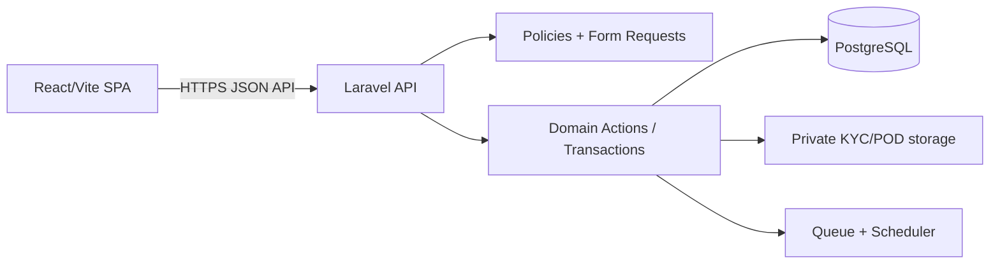

# Proposed Architecture

## Recommendation

Laravel + PostgreSQL is the proposed stack because the prompt specifies it, it offers mature policies, validation, queues and transactions, and it maps cleanly to the existing React SPA. NestJS remains a viable alternative but is not selected without owner approval.

## Boundaries

- Controllers translate HTTP to application actions.
- Form Requests validate shape; Policies enforce ownership/authorization.
- Domain Actions perform transactional writes and idempotency.
- Resources define API response contracts.
- PostgreSQL is the authority for commerce, inventory and finance.
- React keeps loading/error/UI preference state only after migration.
